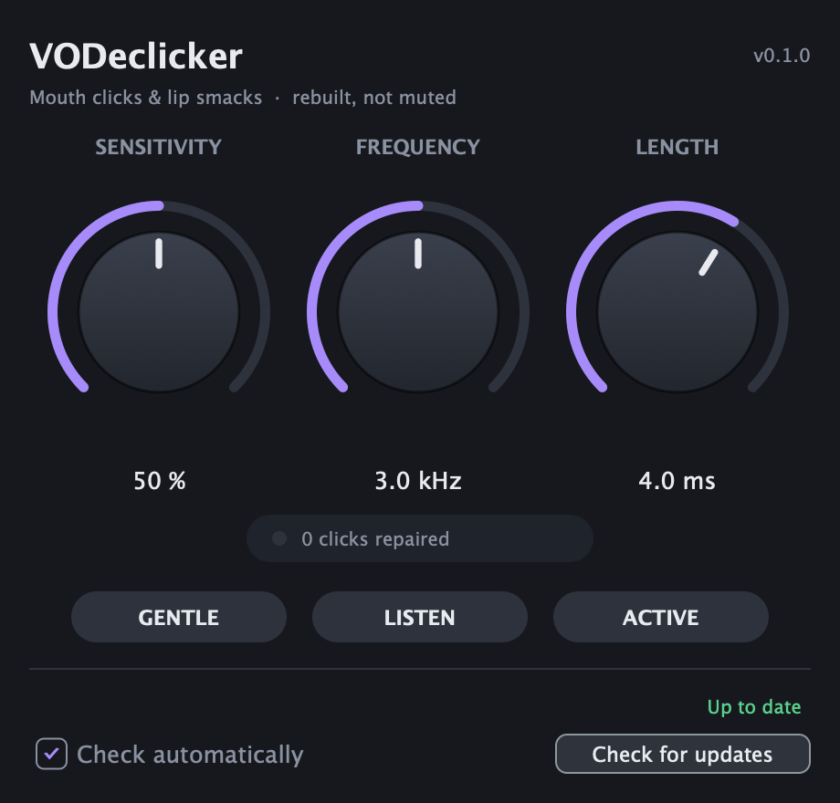

# VODeclicker

VODeclicker removes mouth clicks and lip smacks from voice-over and audio-description narration.
It is available as a VST3 on all platforms, plus an AU on macOS.



Mouth noise is the thing you otherwise razor out by hand: tongue ticks, saliva clicks and lip
smacks in the pauses and at the edges of words. VODeclicker finds them and **rebuilds** those
few milliseconds from the audio either side, so the room tone or breath carries on underneath
instead of dropping out. Everywhere else the audio passes through untouched, bit for bit.

Put it on the narration track, after your EQ and before compression (compression makes clicks
louder and harder to tell from consonants).

## How it works

- **Only the upper band is touched.** Clicks are found above the *Frequency* knob, where they
  stand out from the voice, and rebuilt from an octave below it (1.5 kHz at the default 3 kHz),
  since many clicks carry much of their energy there. The body of the voice below that is
  never changed.
- **Level independent.** A click has to stand out from the high band's own recent level, not
  cross a fixed dBFS threshold, so it behaves the same on a quiet −29 LUFS take as on a hot one.
- **Short and settled.** A click must be over within *Length*, and afterwards the high band has
  to drop back to where it was. An "s", breath, or a "t"/"k" release that runs into aspiration
  and the vowel fails one of those tests and is left alone. A lip smack made of several pops a
  few milliseconds apart is recognised as a train and repaired pop by pop.
- **Rebuilt, not muted.** The span is replaced by autoregressive predictions from the audio
  before and after it, cross-faded, with a little noise shaped like the surrounding sound so
  longer smacks keep the room's texture.
- **Latency:** 24 ms, reported to the host (Logic compensates automatically; its low-latency
  mode bypasses the plugin while you record).

## Controls

The main window is one knob. Most voices only need **Sensitivity**; the rest sits under
**Advanced** (click it to open the panel below; the plugin remembers whether it was open).

| Control | Range (default) | What it does |
|---------|-----------------|--------------|
| Sensitivity | 0–100 % (50 %) | How far above the surrounding high band a sound must jump to count as a click. 0 % turns repairs off. |
| Listen | off | Hear only what is being removed, to check it isn't eating consonants. |
| Bypass | off | Click-free bypass, also linked to your DAW's bypass. Latency-compensated, so A/B is exact. |
| *Advanced:* Frequency | 1–8 kHz (3 kHz) | Split point: clicks are looked for above it and rebuilt from an octave below it. Lower it for thumpier smacks, raise it for very bright voices. |
| *Advanced:* Length | 0.5–8 ms (6 ms) | The longest noise treated as a click. Raise it for wet lip smacks; anything longer is speech. |
| *Advanced:* Gentle / Strong | Gentle | Gentle repairs clicks in pauses and at word edges, and stays out of voiced speech. Strong also repairs clicks inside words. |

All of them are host parameters, so the advanced ones can still be automated while the panel
is closed. The counter under the knob shows how many clicks have been repaired since the
plugin was opened, and its dot lights up on each repair.

## Usage tips

- Start at the defaults and adjust only **Sensitivity**. Play a section with **Listen** on: you should hear
  isolated ticks and smacks, not the start of words. If you hear consonants ("t", "k", "ch"),
  lower Sensitivity or Length.
- Use **Strong** for takes with clicks inside words (a dry mouth), and check it with Listen:
  it is much busier than Gentle.
- Long, wet smacks: raise **Length** to 8 ms, and if they're low and thumpy, lower
  **Frequency** to 2 kHz.

## Install

Download the zip for your system from the
[latest release](https://github.com/kyle95wm/vo-declicker/releases/latest), extract it, and run
the included installer, or copy the plugin yourself:

| OS      | Installer             | Manual location |
|---------|-----------------------|-----------------|
| macOS   | `./install.sh`        | `VODeclicker.vst3` → `~/Library/Audio/Plug-Ins/VST3`, `VODeclicker.component` → `~/Library/Audio/Plug-Ins/Components` |
| Windows | `install.ps1` (right-click → Run with PowerShell) | `VODeclicker.vst3` → `C:\Program Files\Common Files\VST3` |
| Linux   | `./install.sh`        | `VODeclicker.vst3` → `~/.vst3` |

One-line install of the latest release:

```bash
curl -fsSL https://raw.githubusercontent.com/kyle95wm/vo-declicker/main/scripts/install.sh | bash
```

```powershell
# Windows, from an Administrator PowerShell
irm https://raw.githubusercontent.com/kyle95wm/vo-declicker/main/scripts/install.ps1 | iex
```

**Logic Pro** only loads Audio Units, so use the AU (`install.sh` installs both). VODeclicker
appears under **Audio Units → kyle95wm**, next to the other kyle95wm plugins.

**macOS note:** the builds are ad-hoc signed but not notarised. `install.sh` removes the
quarantine flag for you. If you copy the plugin by hand and macOS blocks it, run
`xattr -dr com.apple.quarantine ~/Library/Audio/Plug-Ins/VST3/VODeclicker.vst3` (and the same for the `.component`).

## Updates

The plugin window checks this repo's GitHub Releases (at most once a day) and shows
**Update available** with a Download button when there's a newer version. You can turn off
automatic checks with the *Check automatically* box, or check by hand with *Check for updates*.
The check is a single anonymous request to `api.github.com`. Nothing else is sent.

## Building from source

You need CMake 3.22+, a C++17 compiler, and Git. JUCE is downloaded automatically.

```bash
cmake -S . -B build -DCMAKE_BUILD_TYPE=Release
cmake --build build --config Release --parallel
ctest --test-dir build -C Release --output-on-failure
```

The plugins end up in `build/VODeclicker_artefacts/Release/`. Add `-DVO_DECLICKER_COPY_AFTER_BUILD=ON`
to install them into your user plug-in folders after each build.

- **macOS:** Xcode or the Command Line Tools. Add `-DCMAKE_OSX_ARCHITECTURES="arm64;x86_64"` for a universal build.
- **Windows:** Visual Studio 2022 or newer with the C++ workload.
- **Linux (Debian/Ubuntu):**
  ```bash
  sudo apt install build-essential cmake git libasound2-dev libjack-jackd2-dev libcurl4-openssl-dev \
    libfreetype-dev libfontconfig1-dev libx11-dev libxcomposite-dev libxcursor-dev libxext-dev \
    libxinerama-dev libxrandr-dev libxrender-dev libglu1-mesa-dev mesa-common-dev
  ```

Options: `-DVO_DECLICKER_BUILD_AU=OFF`, `-DVO_DECLICKER_BUILD_STANDALONE=ON`, `-DVO_DECLICKER_JUCE_PATH=/path/to/JUCE`.

The test tool can also run your own recordings through the plugin, which is handy when tuning:

```bash
./build/VODeclickerTest_artefacts/Release/VODeclickerTest --render take.wav [outDir]
```

It writes `take_Gentle50.wav`, `take_Strong50.wav`, the matching `_listen` files (only what was
removed) and `_repairs.txt` label lists (Audacity format: start, end, peak removed), and prints
how many spans were repaired and how many click-like events were left alone because they didn't
settle.

To refresh the README screenshot after changing the UI, build with
`-DVO_DECLICKER_BUILD_SCREENSHOT_TOOL=ON` and run
`./build/VODeclickerScreenshot_artefacts/Release/VODeclickerScreenshot docs/screenshot.png`.

## Releasing

1. Push a tag: `git tag v1.0.0 && git push origin v1.0.0`
2. GitHub Actions builds Windows, macOS (universal) and Linux, runs the tests, and publishes a
   Release with the zips and install scripts. The version inside the plugin comes from the
   tag, so the update checker always compares against the right number.

## License

AGPL-3.0, as required by JUCE's open-source license. VST is a trademark of Steinberg Media Technologies GmbH.
